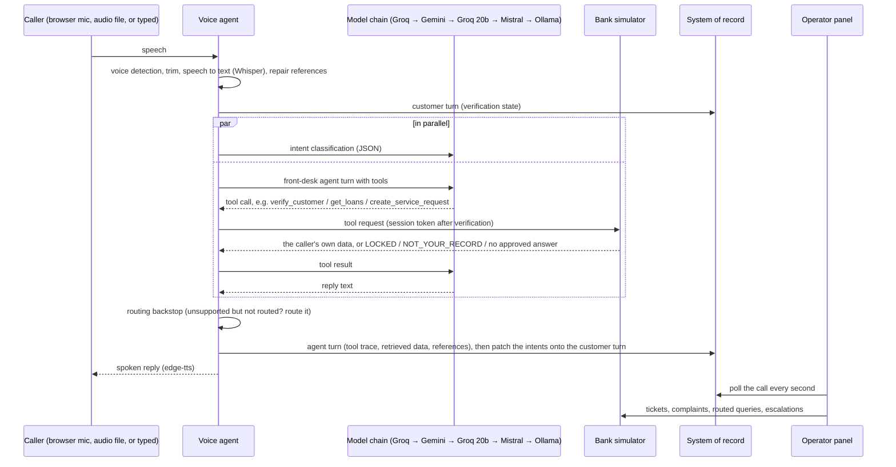

# Architecture

A customer-service voice agent for a bank (problem #05), on synthetic data. Four services, each owning its own data:

| Service | Path | Port | Owns |
|---|---|---|---|
| Voice agent | `backend/voice` | 7861 | The conversation: speech in and out, intent detection, the front-desk agent and its tools, escalation, recorded-audio simulation |
| Bank simulator | `backend/simulator` | 8090 | The bank's systems: customers, loan applications, loans, accounts and transactions, insurance, the CSM platform (tickets, complaints, routed queries, escalations), verification and lockouts, the approved FAQ |
| System of record | `backend/api` | 8080 | Call records and per-turn metadata, the renewal desk's guard rails, the hash-chained audit log, staff sign-in |
| Operator panel | `frontend` | 5173 | What staff see: calls, turns, intents, verification state, the data behind each reply, bank records, search |

The voice agent never holds bank data. It asks the simulator through tools, and the simulator decides what the verified caller may see. Every turn is written to the system of record, so the operator panel shows exactly what happened.

## One call, end to end

**Three ways in, one agent.** The browser microphone (WebRTC through Pipecat), recorded files (`POST /sim/audio`) and typed turns (`POST /support/text-turn`) all reach the same `SupportBrain`. Live and recorded audio share the same speech front end.

**Live turn-taking.** Silero voice detection (confidence 0.7, stop after 0.4 s of silence) marks speech. Transcripts are gathered until the caller has been quiet for 1 s (`VOICE_TURN_SETTLE_SECS`), then answered once. If the caller starts speaking, audio already playing is cut, and a reply still being prepared is dropped; the agent's context records that the caller never heard it.

## Verification and security

Both layers enforce verification: the voice tool layer refuses personal tools before verification without making any request, and the simulator requires a session token on every personal endpoint, so a prompt-injected tool call still gets nothing.

| Rule | Enforced by |
|---|---|
| Verify by registered mobile and date of birth; 15-minute session bound to one customer | simulator `/v1/verify`, `X-Customer-Session` |
| No attempt spent without a 10-digit mobile and a real date | voice tool layer |
| 3 failures lock that customer for 15 minutes, across calls | simulator (`LOCKED`) |
| One caller failing for 3 different customers, or 6 times, within 30 minutes is blocked; a `SECURITY` escalation is raised | simulator (`CALLER_BLOCKED`) |
| Another customer's record is refused | simulator (`NOT_YOUR_RECORD`) |
| Staff roles: only the voice service writes call records; analysts, reviewers and admins read | system of record |
| Audit: call start, end and outcome, renewal verification, quotes and hand-offs, hash-chained | system of record, `/api/v1/audit/verify` |

## What the agent may say

- **Figures:** only values present in that turn's tool results. The tool layer adds a spoken form next to every rupee amount.
- **Product questions:** only from the approved FAQ. The simulator's search (SQLite FTS5, BM25, Porter stemming, a minimum score) returns nothing for off-topic questions, which the agent then declines and routes.
- **Unsupported requests:** always routed. If the intent detector labels a turn unsupported and the model did not route or escalate it, the brain routes it.
- **Hand-over to a person:** a first plain request is answered with a question (`ASK_FIRST`), and a second hands over. The agent also hands over unasked when the caller is dissatisfied, when it could not help, and at once for fraud or distress. Phone calls are transferred to `HUMAN_AGENT_NUMBER`; browser callers get a call-back promise, the reference and the helpline number.

## Models

| Use | Model |
|---|---|
| Speech to text | Groq `whisper-large-v3-turbo`, English pinned, banking vocabulary prompt |
| Conversation and tools | `VOICE_LLM_CHAIN`, default Groq `openai/gpt-oss-120b` → Gemini `gemini-3-flash-preview` → Groq `openai/gpt-oss-20b` → Mistral `mistral-small-latest` → local Ollama `llama3.2` |
| Intents | Groq `openai/gpt-oss-20b` in JSON mode, 1.5 s timeout, falling back to keyword rules |
| Speech out | edge-tts `en-IN-NeerjaNeural` |

A link that hits a rate limit, outage or timeout rests for a while and the next one answers. Free tiers cap tokens per minute, so each call sends only the last 6 caller turns, with older tool results shortened. No Anthropic model is used at runtime, and the configuration refuses one.

## Speech front end, and why

The settings in `backend/voice/app/speech.py` come from a measured benchmark: 102 synthetic clips in Indian, British, Nigerian and American voices, clean and with café babble at 5 dB. See [docs/stt-benchmark.md](docs/stt-benchmark.md). In short:
- the vocabulary prompt cut word errors from 4.6% to 3.7%, and in noise from 7.3% to 5.1%;
- noise reduction made things worse, so it is off;
- voice detection stops pure noise reaching speech-to-text;
- spoken references are repaired ("S R four zero one zero two" → `SR-40102`).

## Data

All data is synthetic.
- **Simulator:** loads read-only seed files (`backend/simulator/data/seed/*.json`). New tickets, complaints, routed queries, escalations, verification attempts, sessions and lockouts go to SQLite. `POST /v1/ops/reset` clears them.
- **System of record:** keeps calls, turns and the audit log in SQLite (`API_DB_PATH`), and seeds the renewal book from `backend/api/app/resources/seed/renewal_seed.sql`.

## Contracts

The HTTP contracts between the services are written down once and the services are built against them:
- the simulator API, and the call-record and `/sim/audio` shapes: "Shared contract" sections in `docs/superpowers/plans/2026-10-31-csm-voice-agent.md`;
- the voice agent's tool definitions: `backend/voice/app/support_tools.py`;
- fixed vocabularies (intents, outcomes, channels, error codes, routes): enums in each service (`backend/voice/app/vocab.py`, `backend/simulator/app/enums.py`, `backend/api/app/vocab.py`, `frontend/src/vocab.ts`).

## Renewal Desk

The earlier outbound agent is still in the repo. It phones a policyholder about a renewal. The system of record decides what may be offered (playbook limits, discount caps, hand-off after repeated out-of-policy requests, calling hours), and the agent only relays it. Its pipeline is `backend/voice/app/pipeline.py`, and its prompt is `backend/voice/app/prompt.py`.
