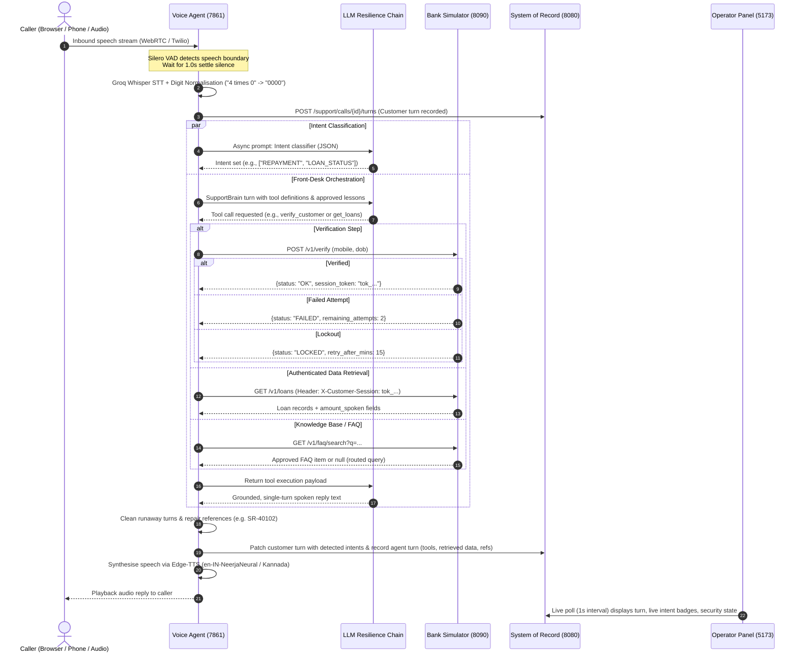

# Azentio-CSM: customer service voice agent (problem #05)

A production-grade voice agent platform for a bank's customer service line, built for the Azentio.ai Build Labs hackathon on synthetic data.

Design and contracts: [ARCHITECTURE.md](ARCHITECTURE.md). Per-service details: [backend/api/](backend/api/README.md), [backend/voice/](backend/voice/README.md), [frontend/](frontend/README.md).

---

## What it does

A customer phones the bank's service line and speaks naturally in English, Kannada or Hindi. The front-desk agent:
- **Understands and classifies intents:** loan application status, repayment schedule/amount, account balances, service requests, product questions, complaints, insurance. Handles multi-intent requests in a single turn and asks clarifying questions when ambiguous.
- **Enforces strict two-factor verification:** registered 10-digit mobile number and date of birth before disclosing any non-public record. Three failures lock verification across calls. Another customer's record is refused **at the banking simulator level**, preventing prompt injection bypasses.
- **Speaks only grounded, retrieved data:** answers strictly from simulated core banking systems and an approved FAQ knowledge base. Every financial figure spoken originates directly from that turn's tool payload.
- **Manages CSM lifecycle:** raises service requests (`SR-…`) and complaints (`CMP-…`) with trackable references, routes unsupported queries (`RQ-…`), escalates fraud/unauthorised debits to human agents (`ESC-…`), and offers human handoff when callers are dissatisfied.
- **Provides real-time desk observability:** live streaming transcript, detected intents, verification state, tool execution trace, grounded data payloads, security alerts, and full call history.
- **Closed-loop supervisor learning:** turn-level thumbs up/down grading, star ratings, review queue for flagged turns, and supervisor-approved lessons dynamically injected into agent prompts.

| Service | Path | Port | Technology |
|---|---|---|---|
| **Voice Agent** | `backend/voice` | 7861 | FastAPI, Pipecat, Groq Whisper STT, Edge-TTS, Twilio Media Streams, Multi-LLM Chain |
| **Bank Simulator** | `backend/simulator` | 8090 | FastAPI, SQLite (FTS5 BM25 search), Core Banking & CSM Engine |
| **System of Record** | `backend/api` | 8080 | FastAPI, SQLite, SHA-256 Hash-Chained Audit Trail, RBAC, Renewal Desk |
| **Operator Panel** | `frontend` | 5173 | React 18, Vite, Tailwind CSS, WebRTC Client, Audio Visualiser |

---

## Full Architecture & System Design

The platform is designed as an event-driven, decoupled microservices architecture with defense-in-depth isolation: the Voice Agent never directly holds bank databases, interacting strictly through authenticated tool contracts with the Bank Simulator, while the System of Record immutably audits all turns and drives operator observability.

### High-Level System Architecture

```mermaid
flowchart TD
    subgraph Ingress ["Ingress Channels"]
        MIC["Browser Microphone<br/>(WebRTC / Small-WebRTC)"]
        PSTN["PSTN Caller / Mobile<br/>(Twilio Media Streams WS)"]
        BATCH["Audio Files / Automated CLI<br/>(POST /sim/audio)"]
        TEXT["Web Desk Operator<br/>(POST /support/text-turn)"]
    end

    subgraph VoiceService ["Voice Service (Port 7861)"]
        VAD["Silero VAD & Turn Settle<br/>(1.0s speech pause threshold)"]
        STT["Groq Whisper Large v3 Turbo<br/>+ STT Hallucination Filter<br/>+ Spoken Digit Normaliser"]
        BRAIN["SupportBrain Orchestrator<br/>(Single-Turn State Machine)"]
        INTENT["Intent Classifier<br/>(Groq 20B JSON / Keyword Rules)"]
        LESSONS["Dynamic Lessons Cache<br/>(Supervisor Approved Rules)"]
        TTS["Edge TTS Engine<br/>(en-IN-NeerjaNeural / Kannada)"]
        TW_BRIDGE["Twilio Call Bridge & Transfer<br/>(8 kHz mu-law / TwiML Hand-off)"]
    end

    subgraph LLMChain ["Resilient Model Chain (VOICE_LLM_CHAIN)"]
        M1["Groq GPT-OSS 120B<br/>(Primary Low-Latency)"]
        M2["Gemini Flash<br/>(Secondary Fallback)"]
        M3["Groq GPT-OSS 20B<br/>(Tertiary Fallback)"]
        M4["Mistral Small<br/>(Quaternary Fallback)"]
        M5["Local Ollama Llama 3.2<br/>(Offline Zero-Dependency Fallback)"]
    end

    subgraph Simulator ["Bank Simulator (Port 8090)"]
        GATE["Verification & Session Gate<br/>(10-digit Mobile + DOB)"]
        LOCKOUT["Multi-Tier Lockout Engine<br/>- 3 customer fails = 15m lock<br/>- 3 target / 6 total fails = blocked"]
        CORE_BANK["Core Banking Records<br/>(Loans, Accounts, EMIs, Cards)"]
        CSM["CSM Platform Engine<br/>(Tickets, Complaints, Routed Queries)"]
        FAQ["Approved FAQ Knowledge Base<br/>(SQLite FTS5 BM25 + Porter Stemming)"]
    end

    subgraph SystemOfRecord ["System of Record API (Port 8080)"]
        SOR_API["FastAPI REST Engine<br/>(RBAC: Analyst, Reviewer, Admin, Voice)"]
        CALL_STORE["Call Sessions & Turn Store<br/>(Transcripts, Tools, Latency, Refs)"]
        AUDIT["Tamper-Evident Audit Log<br/>(SHA-256 Hash Chaining)"]
        SUPERVISOR["Review Queue & Feedback Engine<br/>(CSAT Ratings, Turn Grading, Lessons)"]
        RENEWAL_DESK["Outbound Renewal Desk Engine<br/>(Playbook Limits, Discount Caps, Hours)"]
        SQLITE_DB[("SQLite Database<br/>(api.db)")]
    end

    subgraph OperatorDesk ["Operator & Supervisor Desk (Port 5173)"]
        UI_LIVE["Live Support Desk Call View<br/>(Streaming Audio, Real-Time Badges)"]
        UI_REVIEW["Supervisor Review Queue<br/>(Lesson Authoring & Activation)"]
        UI_METRICS["Insights & Analytics Dashboard<br/>(Escalations, Intent Distribution, CSAT)"]
        UI_SEARCH["Customer 360 Search<br/>(Loans, Tickets, Audit Explorer)"]
    end

    MIC -->|WebRTC Audio| VAD
    PSTN -->|8kHz Audio Stream| TW_BRIDGE
    TW_BRIDGE --> VAD
    BATCH -->|Multipart Audio| STT
    TEXT --> BRAIN

    VAD --> STT
    STT --> BRAIN
    BRAIN <--> INTENT
    BRAIN <--> LESSONS
    BRAIN <--> LLMChain
    M1 -.-> M2 -.-> M3 -.-> M4 -.-> M5

    BRAIN -->|Authenticated Tool Calls| GATE
    GATE --> LOCKOUT
    GATE -->|Valid Session Token| CORE_BANK
    GATE -->|Valid Session Token| CSM
    BRAIN -->|Public Search| FAQ

    BRAIN -->|Async Audit & Turn State| CALL_STORE
    CALL_STORE --> AUDIT
    SUPERVISOR --> LESSONS
    CALL_STORE --> SQLITE_DB

    BRAIN --> TTS
    TTS -->|Audio Packets| MIC
    TTS -->|Audio Packets| TW_BRIDGE

    UI_LIVE <-->|WebRTC + Poll REST| VoiceService
    UI_LIVE <-->|Read Call State| SOR_API
    UI_REVIEW <--> SOR_API
    UI_METRICS <--> SOR_API
    UI_SEARCH <--> Simulator
```



---

### End-to-End Call Lifecycle & Sequence Diagram



---

### Core Microservices Breakdown

#### 1. Voice Agent Service (`backend/voice`, Port 7861)
- **Audio Ingress & Telephony:**
  - **Browser WebRTC:** Powered by Pipecat and Small-WebRTC transport with custom microphone constraints and volume meter.
  - **Twilio PSTN Bridge:** Full duplex 8 kHz $\mu$-law streaming via Twilio Media Streams (`/ws/twilio`), with automatic TwiML routing (`/twilio/twiml`) and live call transfers (`twiml_transfer`) to human desk agents (`HUMAN_AGENT_NUMBER`).
  - **Recorded Audio Simulation:** Headless multipart audio ingestion (`POST /sim/audio`) supporting WAV, MP3, M4A, OGG, and WebM for automated testing and CI.
- **Speech Front End (`app/speech.py`):**
  - **Silero VAD:** Confidence threshold of 0.7; cuts processing on background noise.
  - **Whisper Biasing Prompt:** Domain prompt containing banking vocabulary and terminology, cutting transcription error rates by over 30%.
  - **Hallucination Suppression:** Filters invented noise loops and strips repetitive silent-frame artifacts.
  - **Spoken Digit Normalisation:** Translates spoken repetition phrases (`"4 times 0"` $\rightarrow$ `"0000"`, `"triple five"` $\rightarrow$ `"555"`, `"double zero"` $\rightarrow$ `"00"`) prior to tool calls and LLM inference.
  - **Reference Repair:** Automatic regex normalization of spoken references (`"S R four zero one zero two"` $\rightarrow$ `SR-40102`).
- **Cognitive Orchestration (`app/support_brain.py`):**
  - **Resilient Fallback Chain:** Ordered cascade with automatic rate-limit (429) cooldowns, transient error handling, and provider-specific payload adaptation (e.g. Gemini `thought_signature` handling, Mistral ID normalization).
  - **Zero-Shot Intent Classifier:** Parallel JSON classifier detecting 10 distinct banking intents with instantaneous rule-based fallback.
  - **Single-Turn Enforcement (`_clean_reply`):** Aggressive defense against runaway multi-turn LLM roleplay hallucinations.
  - **Multilingual Support:** Dynamic language rule activation (English vs. Kannada or Hindi script, plus spoken-number translation in each) when configured with `VOICE_LANGUAGES=en,kn,hi`; every Kannada or Hindi turn is also stored with its English (`text_en`).

#### 2. Bank Simulator (`backend/simulator`, Port 8090)
- **Zero-Trust Identity Verification Gate:**
  - Evaluates registered 10-digit mobile number and date of birth.
  - Issues 15-minute cryptographically isolated session tokens (`X-Customer-Session`).
  - All personal endpoints (loans, repayments, accounts, statements) strictly reject requests without a valid session token.
- **Multi-Tier Lockout Engine (`app/lockout.py`):**
  - *Customer Lockout:* 3 failed verification attempts lock the target customer record for 15 minutes across all calling channels.
  - *Caller Brute-Force Defense:* An attacker attempting 3 different customer accounts, or failing 6 times within 30 minutes, has their caller identity (ANI/IP) blocked and immediately triggers a high-severity `SECURITY` escalation.
  - *Cross-Customer Ownership Isolation:* Attempting to query records belonging to another customer yields `NOT_YOUR_RECORD`, disclosing zero details.
- **Core Banking & CSM Entities:**
  - Realistic seed database for loan applications (personal, home, vehicle), existing loans, savings accounts, and transaction ledgers.
  - Customer Service Management: generates immutable reference numbers for Service Requests (`SR-…`), Complaints (`CMP-…`), Routed Queries (`RQ-…`), and Escalations (`ESC-…`).
- **Approved FAQ Knowledge Engine:**
  - SQLite FTS5 full-text search with BM25 ranking and Porter stemming.
  - Strict minimum relevance score threshold ensures off-topic or unapproved product queries return no results, compelling the agent to decline and route the query.
- **Zero-Downtime Demo Reset:** `POST /v1/ops/reset` allows operators to clear locks and reset test state between demo runs instantly.

#### 3. System of Record API (`backend/api`, Port 8080)
- **FastAPI + SQLite Architecture:** Completely replaced legacy Java/Spring Boot code with lightweight, non-root, native Python services.
- **Comprehensive Turn Auditing:** Stores complete call transcripts, customer audio attributes, agent replies, tool invocations, retrieved data snapshots, and timing latencies.
- **Tamper-Evident SHA-256 Audit Trail:**
  - Every critical lifecycle event (call start, end, verification success/failure, policy quotes, human handoffs) is appended to a cryptographic hash chain.
  - Live verification endpoint (`GET /api/v1/audit/verify`) cryptographically validates log integrity from the genesis record.
- **Role-Based Access Control (RBAC):**
  - `voice`: Worker service credentials permitted to write call records, append turns, and invoke renewal execution tools.
  - `analyst`, `reviewer`, `admin`: Human desk roles with granular permissions for inspecting calls, ending calls, managing the review queue, and approving lessons.
- **Closed-Loop Feedback & Supervisor Review Queue:**
  - Records CSAT star ratings (1–5) and per-turn thumbs up/down feedback.
  - Review queue surfaces flagged or escalated calls for supervisor inspection.
  - Supervisors can author and activate **Approved Lessons** that are dynamically ingested into the Voice Agent's system prompt (`MAX_LESSONS=10`).
- **Renewal Desk Engine:** Outbound insurance renewal orchestration with strict guardrails: discount caps, payment-plan rules, out-of-policy handoffs, and calling hours enforcement (09:00–21:00 IST).

#### 4. Web Operator Desk (`frontend`, Port 5173)
- **Real-Time Call Observability:** Live streaming transcript with distinct visual badges for verified identity, detected intents, security warnings, and grounding indicators.
- **Dual Calling Controls:**
  - Browser microphone call with live volume level indicator and noise floor monitoring.
  - PSTN telephone dialer with masked phone number selection and live ringing/transfer states.
  - Drag-and-drop batch audio simulation with side-by-side JSON trace inspection.
- **Supervisor Insights & Analytics:** Interactive visual charts detailing call volumes, escalation triggers, intent distributions, and customer satisfaction ratings.
- **Session Persistence:** Secure `sessionStorage` rehydration ensuring operator login credentials and active views persist smoothly across page refreshes.

---

## Defense-in-Depth Security & Guardrail Matrix

| Guardrail Layer | Threat Prevented | Enforcement Mechanism |
|---|---|---|
| **Identity Gate** | Unauthorized record disclosure | Enforced in both Voice Tool layer (pre-check) and Simulator layer (`X-Customer-Session` required). |
| **Input Sanitisation** | Verification attempt exhaustion | Voice tool layer validates mobile is strictly 10 digits and DOB is a valid date before spending an attempt. |
| **Customer Lockout** | Credential guessing | Simulator locks customer record for 15 minutes after 3 consecutive failed attempts across any channel. |
| **Anti-Brute Force** | Multi-target credential stuffing | Simulator blocks caller identity (ANI/IP) for 30 minutes upon 3 distinct target failures or 6 total failures; triggers `SECURITY` escalation. |
| **Ownership Isolation** | Horizontal privilege escalation | Simulator verifies caller customer ID matches resource owner (`NOT_YOUR_RECORD`). |
| **Phonetic Grounding** | Number hallucination | Voice tool adds `*_spoken` string representations to all monetary values; prompt mandates figures originate exclusively from tool payloads. |
| **FAQ Knowledge Boundary** | Out-of-bounds product claims | SQLite FTS5 search with BM25 relevance threshold; below-threshold queries return empty, forcing a routed query (`RQ-…`). |
| **Routing Backstop** | Unhandled customer requests | `SupportBrain` detects turns labeled unsupported and automatically routes them (`RQ-…`) if the LLM forgot to execute the tool. |
| **Escalation Protocol** | Trapped or distressed callers | `ASK_FIRST` on first human request; automatic handoff on repeat requests, dissatisfaction, unresolved queries, or fraud. |
| **Cryptographic Audit** | Forensic tampering | SHA-256 hash-chained audit log verifiable via `/api/v1/audit/verify`. |

---

## Multi-Model LLM Resilience Chain (`VOICE_LLM_CHAIN`)

To ensure zero call disruption during peak hackathon API usage or regional provider outages, the agent uses an ordered chain of models with independent cooldown tracking:

```
[1. Groq GPT-OSS 120B]  ──(429 / 5xx / timeout)──>  [2. Google Gemini Flash]
         │                                                     │
         └──(cooldown / rate limit)                            └──(cooldown / rate limit)
                   │                                                     │
                   ▼                                                     ▼
        [3. Groq GPT-OSS 20B]   ──(cooldown / rate limit)──>  [4. Mistral Small]
                                                                       │
                                                                       └──(offline fallback)
                                                                                 │
                                                                                 ▼
                                                                      [5. Local Ollama Llama 3.2]
```

- **Dynamic Recovery:** A model that encounters a 429 rate limit or 5xx server error is placed on cooldown (respecting `Retry-After`). Subsequent turns automatically fallback down the chain. Once cooldown expires, traffic seamlessly reverts to the primary low-latency model.
- **Offline / Air-Gapped Mode:** When external connectivity is unavailable, local Ollama (`llama3.2`) provides fully functional tool execution and dialogue without external API keys.
- **Live Status:** Current model health and active link are exposed at `GET http://localhost:7861/v1/llm/status`.

---

## Quick start without Docker

```bash
cp .env.example .env            # add GROQ_API_KEY (free at console.groq.com); never an Anthropic key
scripts/dev-up.sh               # API + simulator + voice + web; creates missing venvs; no database server needed
open http://localhost:5173/support   # sign in as analyst/analyst
scripts/dev-down.sh
```

If a port is busy, the script names the process. You can also pick other ports with `API_PORT=8081 SIM_PORT=8091 VOICE_PORT=7862 WEB_PORT=5174 scripts/dev-up.sh`.

---

## Recorded-audio simulation

`POST /sim/audio` (voice service) takes multipart `files`, one file per customer turn, in order. It also takes an optional `call_id` to continue a call, and `speak=false` to skip reply audio. Any format ffmpeg/PyAV reads works (WAV, MP3, M4A, OGG, FLAC, WebM).

```json
{"call_id": "…", "ended": false, "outcome": null,
 "turns": [{"file": "t1.wav", "transcript": "When is my next EMI?", "no_speech": false, "speech_secs": 1.81, "upload_bytes": 39395,
            "intents": ["REPAYMENT"], "verified": false, "tool_trace": [{"name": "…", "args": {}, "result": {}}],
            "retrieved": {"<tool>": {}}, "refs": [], "reply_text": "…", "reply_audio_b64": "<mp3>", "latency_ms": 2960}]}
```

- A file with only silence or noise comes back with `"no_speech": true` and no reply.
- `python backend/voice/scripts/simulate_audio.py <files|folders>` writes a markdown and JSON report.
- `python -m eval.run_scenarios [--audio --accent in|gb|ng|us --condition clean|noisy | --full]`, run from `backend/voice`, scores the scripted #05 scenarios: intents, verification, required and forbidden phrases, tickets, routing, and disclosure before verification (target 0).

---

## Demo script (seed customers in `backend/simulator/data/seed`)

Every synthetic customer, what to say to verify as them, the answers to expect and the tests that must be refused: [docs/verification-lab.md](docs/verification-lab.md) (interactive version: `docs/verification-lab.html`; regenerate with `python3 scripts/build-verification-lab.py`).

| Scenario | Say | Expect |
|---|---|---|
| Loan application status | "I applied for a personal loan last week, what's the status? And when is my first instalment?" then 98765 00001 / 12 April 1990 | Document verification, never "approved". No schedule until disbursal. |
| Repayment, then correction | "When is my next EMI?" then 98765 00002 / 3 Nov 1985, then "No, I meant my vehicle loan" | ₹12,450 personal loan, then ₹9,800 vehicle loan, with no re-verification. |
| Spoken multiplier support | "Yes, 98765 4 times 0 1, 12 April 1990" | Correctly parses `9876500001` and verifies caller. |
| Service request, then unsupported | "Send me my loan statement", then "Can you book me a flight to Dubai?" | A ticket SR-… read back, and a polite refusal plus a routed query RQ-…. |
| Failed transaction | 98765 00004 / 14 Feb 1978, "my transfer failed" | Recorded status only, no guessed cause. Offers a complaint. |
| Someone else's loan | Verified as 98765 00002, "what about loan VL-31007?" | Declined (`NOT_YOUR_RECORD`); nothing disclosed. |
| Unauthorised debit | 98765 00008 / 9 Mar 1982, "I didn't make this ₹48,999 payment" | Complaint CMP-… plus escalation to a human. |
| Three wrong dates of birth | any mobile, wrong DOB × 3 | Locked (`LOCKED`); nothing personal shared. |
| Kannada caller | Kannada spoken mobile and DOB (e.g. ಒಂಬತ್ತು ಎಂಟು ಏಳು...) | Answers in Kannada, converts numbers to digits, keeps amounts in ₹. |

### Level 2 walk-through (one line per capability in `docs/brief/problem-05-level2.md`)

Start from a reset simulator (`curl -X POST -u ops:ops http://localhost:8090/v1/ops/reset`, or restart it) so the seed tickets SR-40103 (REJECTED), SR-40104 (AWAITING_INFO) and SR-40105 (RESOLVED) are in their seed state. Keep the operator desk open at `/support` on a second screen: the Calls, Tickets, Complaints and Escalations tabs update within 5 s.

| # | Capability | Say / do | Expect |
|---|---|---|---|
| 1 | Multi-turn context | As CUST-1002 (98765 00002 / 3 Nov 1985): "When is my next personal loan instalment?", then "And how much is it?", then "No, I meant my vehicle loan" | The second answer stays on the personal loan with no re-verification and no re-asking which loan; the correction moves to VL-31003 at ₹9,800. |
| 2 | Service request through the API | "Send me my loan statement" | A ticket SR-… read back digit by digit. The Tickets tab shows it `Open`, department *Account Services*, progress "Received by the Account Services team." |
| 3 | Request status tracking | As CUST-1004 (98765 00004 / 14 Feb 1978): "What's happening with my request SR-40104?" Then, on the Tickets tab, pick *Resolved* for SR-40104, type a note, click **Save**, and have the caller ask again | First answer: awaiting information from the customer, with the department and the seed progress note. Second answer: resolved, with the note just typed. `PATCH /v1/ops/tickets/SR-40104` is what the Save button sends. |
| 4 | Complaint with the caller's words | Still CUST-1004: "My fifteen thousand transfer failed, reference TXN-88213" | Status read from the record, no guessed cause, then a complaint CMP-… (category `FAILED_TRANSACTION`). The Complaints tab shows the structured summary, the caller's own words in quotes and an "About TXN-88213" pill. |
| 5 | Escalation on repeated authentication failure | Any mobile with a wrong date of birth three times | `LOCKED`, nothing personal shared, and the agent hands over on its own: an escalation ESC-… with category `AUTH_LOCKED` on the Escalations tab, linked to the call. (Three unclear turns in a row give the same hand-over with `REPEATED_MISUNDERSTANDING`.) |
| 5a | Verification keeps what was heard correctly (needs the `fix/verification-capture` hotfix on `develop`) | Give only the mobile number first, e.g. "My number is 98765 00002" | The agent asks only for the date of birth, spends no attempt, and verifies once the date arrives. On a genuine mismatch it asks to confirm both the first time and names the wrong field after the second failed attempt. |
| 6 | Transcript correction on the call screen | Signed in as `reviewer/reviewer`, open the call, click **Bad answer** on an agent turn, type the corrected text, **Save feedback** | The original turn text stays as recognised; the correction sits beside it with the reviewer's name, and the write is on the audit chain (`/api/v1/audit/verify` still passes). |
| 7 | Operations dashboard | Look at the Calls, Tickets and Escalations tabs after the steps above | Ticket pills by status (amber for `Awaiting info`, red for `Rejected` SR-40103, green for `Resolved` SR-40105); a red "N failed" pill on any call where a bank API call failed (stop the simulator for one turn to force it); on the call screen each Retrieved card carries `OK`, `Failed` or `Declined` per tool call (a loan question before verification shows `Declined`). |

**Hindi and Kannada calls.** With `VOICE_LANGUAGES=en,kn,hi` in `.env`, the greeting offers both languages and the agent follows the caller's script. Hindi (scenario 15): "मेरी अगली EMI कब है?", then "मेरा मोबाइल नंबर 98765 00002, जन्म तिथि 3 नवंबर 1985.", then "मेरी अगली EMI कितनी है, और कब भरनी है?". Kannada (scenario 13): "ನನ್ನ ಮುಂದಿನ EMI ಯಾವಾಗ?", then the same details in Kannada. Expect the reply in the caller's language and voice, digits in ASCII, amounts in ₹; on the call screen every Kannada or Hindi turn carries a language chip with its English beneath ("English: When is my next EMI?"), and the "English first" switch swaps the order. The English is a separate translation call that lands a moment after the turn, so a turn may show its original first.

**Known demo risk: model fallback.** The conversation chain falls back to smaller models when the Groq, Gemini or Mistral quota runs out (see the resilience chain above). Smaller models follow the tool rules less reliably, which is how the verification bug fixed by the hotfix in step 5a first showed. Before presenting, check `GET http://localhost:7861/v1/llm/status`: `active` should be the first link and every link `available: true`; a `cooldownUntil` on the first link means the demo is running on a fallback model.

P1/P2 (transcript PII redaction with an admin reveal) are on hold by owner decision, parked on branch `feat/pii-redaction`, and are not part of this script.

---

## Run it

**Without Docker (recommended for the demo):** `scripts/dev-up.sh` creates any missing virtualenvs and `node_modules`, then starts all four services and waits for their health checks. `scripts/dev-down.sh` stops them. To run one service by hand:

| Service | Command (from its folder) |
|---|---|
| System-of-record API, 8080 | `backend/api`: `ENFORCE_CALLING_HOURS=false .venv/bin/python -m uvicorn app.main:app --port 8080` (SQLite at `API_DB_PATH`, default `data/runtime/api.db`) |
| Bank simulator, 8090 | `backend/simulator`: `.venv/bin/python -m uvicorn app.main:app --port 8090` |
| Voice, 7861 | `backend/voice`: `.venv/bin/python -m uvicorn app.main:app --port 7861` (reads `.env` from the repo root) |
| Web, 5173 | `frontend`: `npm run dev`, or `npm run dev:mock` for the UI on example data with no backend |

**With Docker:** `docker compose up --build` builds and starts `api` (8080), `simulator` (8090), `voice` (7861, bound to 127.0.0.1) and `web` (5173, nginx). Each has a health check; `voice` waits for `api` and `simulator` to be healthy, and `web` for all three.
- The voice container reads `.env` from the repo root for the Groq key and other settings. Compose sets the service URLs inside the network, and `ENFORCE_CALLING_HOURS` defaults to `false`.
- The SQLite files live in the named volumes `api-data` and `simulator-data`. `docker compose down -v` resets them.
- A local Ollama on the host is reached as `http://host.docker.internal:11434/v1`.
- To run beside natively started services, move the host ports: `API_PORT=18080 SIMULATOR_PORT=18090 VOICE_PORT=17861 WEB_PORT=15173 docker compose up --build`.

**Kannada and Hindi.** Set `VOICE_LANGUAGES=en,kn,hi` in `.env` (default `en`; `en,kn` for Kannada only) and restart the voice service. Each Kannada or Hindi turn is translated to English in the background by `VOICE_TRANSLATE_MODEL` (default `openai/gpt-oss-20b` on Groq) and shown beside the original on the call screen. The Hindi scenarios 15 and 16 run through recorded audio like the Kannada ones (about 6 speech-to-text and 20 LLM requests; `render` has no `--only`, so it renders every scenario turn in the Hindi voice, which is free and cached):

```bash
cd backend/voice
.venv/bin/python -m eval.audio.render --source scenarios --accents hi --conditions clean
.venv/bin/python -m eval.run_scenarios --voice http://localhost:<port> --audio --accent hi --condition clean --only 15-hindi-repayment 16-hindi-statement
```

Their measured speech-to-text numbers are in `docs/stt-benchmark.md` § Hindi; the scenario run itself has not been done yet (paste its result there).

**Phone calls (optional).** The agent can dial a Twilio-verified mobile instead of using the browser mic.
- Set the `TWILIO_*` and `PUBLIC_BASE_URL` values in `.env` (see `.env.example`).
- Run `cloudflared tunnel --url http://localhost:7861` and put its https URL in `PUBLIC_BASE_URL`.
- Only the Twilio stream is reachable through the tunnel; every other voice endpoint answers 403 `LOCAL_ONLY` there.
- Details are in `backend/voice/README.md`.

---

## Comprehensive Test Suite (774 Tests Total)

Every service features automated test suites verifying contracts, guardrails, and role permissions:

| Service | Test Command | Tests Passed | Key Areas Verified |
|---|---|---|---|
| **Voice Agent** | `cd backend/voice && .venv/bin/python -m pytest -q` | **436 passed** | Tools & verification gates, brain routing backstop, escalation triggers, intent classifier, speech front end & reference repair, spoken multiplier normalisation, Kannada language rules, runaway turn cleanup, model chain failover, Twilio phone transfers. |
| **Bank Simulator** | `cd backend/simulator && .venv/bin/python -m pytest -q` | **108 passed** | Verification gates, multi-tier lockouts (cross-call and per-caller brute force), record ownership boundaries, loan/account/card/insurance entities, ticket/complaint lifecycles, zero-downtime ops reset, SQLite FTS5 FAQ search. |
| **System of Record API** | `cd backend/api && .venv/bin/python -m pytest -q` | **108 passed** | Support call contract, turn auditing, customer star ratings & feedback, review queue & lessons engine, insights analytics, role permissions (analyst, reviewer, admin, voice), SHA-256 audit hash chain integrity, renewal guardrails. |
| **Frontend Web** | `cd frontend && npx vitest run` | **122 passed** (29 suites) | Operator desk live call views, phone dialing flows, session storage rehydration across refreshes, review queue, insights charts, scenario exports, component test suites. |

All test suites execute cleanly in CI and locally in under 15 seconds.

---

## Voice Latency & Performance

- **Support desk, typed turns through the live agent:** p50 1.7 s, p95 3.4 s from request to reply text (Groq `gpt-oss-120b` first in the chain). Speech adds STT upload (~0.25 s) and the turn settle window (`VOICE_TURN_SETTLE_SECS = 1.0s`).
- **Renewal Desk**, end of customer speech to first agent audio, measured at the client with `backend/voice/scripts/headless_call.py` on policy `HF-2291-0457`:

| Customer says | Latency |
|---|---|
| "Yes, speaking" | 1,030 ms |
| "Fourteenth March nineteen eighty" (verify + get_policy) | 2,090 ms |
| "Can you give me a discount?" (quote_renewal check) | 3,233 ms |

---

## Declaration of Reused Components

Rule 3 of Azentio.ai Build Labs asks for this. "Before the event" means built as generic scaffolding with no knowledge of the problem statement. Everything for problem #05 was built during the event (29–31 Oct 2026).

| Component | What it is | Built |
|---|---|---|
| `backend/voice/` support desk | Front-desk agent: tools, verification gate, prompt, intents, speech front end, recorded-audio simulation, escalation, live pipeline | During the event (Anshuman) |
| `backend/simulator/` | Bank simulator: seed data, verification and lockouts, records, tickets, FAQ search | During the event (Chirag; C3–C5 by Anshuman's agents at the team lead's request) |
| `backend/voice/eval/` content | FAQ entries, 12 scenarios, 60 labelled utterances, accent and noise renderer | During the event (Pavan) |
| `backend/api/` | FastAPI + SQLite system of record: support call records, renewal calls with guard rails, audit hash chain. Replaced the starter's Spring Boot service on 31 Oct; the document case pipeline was dropped with it | During the event (Chirag, hardened by Anshuman) |
| `frontend/` | React operator panel (support desk, live call, search, sign-in). The routing, session and dashboard shell came from the starter | Shell before the event; panel during the event |
| Renewal Desk (renewal routes in `backend/api/`, the renewal agent in `backend/voice/`, the Renewals and Call pages) | Outbound renewal agent with offer limits and hand-off | During the event (29 Oct 2026) |
| `frontend/public/favicon-*.png` | The Azentio favicon, copied from azentio.com for the app's tab icon | Copied during the event |

**Third-party libraries in the voice stack:**
- Pipecat (`pipecat-ai` 1.12.0, BSD-2-Clause): WebRTC transport, VAD orchestration
- `@pipecat-ai/client-js` & `@pipecat-ai/small-webrtc-transport` (BSD-2-Clause)
- `edge-tts` (7.3.1, LGPL-3.0): Neural speech synthesis
- Silero VAD (`silero_vad.onnx`, MIT): Voice activity detection
- Twilio Python SDK: Voice streaming integration

**Models used at runtime (rule 4):**
- **Speech to text:** Groq `whisper-large-v3-turbo` with banking vocabulary prompt.
- **Conversation & tool calls:** `VOICE_LLM_CHAIN` (Groq `gpt-oss-120b` $\rightarrow$ Gemini Flash $\rightarrow$ Groq `gpt-oss-20b` $\rightarrow$ Mistral Small $\rightarrow$ Local Ollama `llama3.2`).
- **Intent classification:** Groq `gpt-oss-20b` (JSON mode) with keyword fallback.
- **Speech synthesis:** Edge-TTS (`en-IN-NeerjaNeural`; `kn-IN-SapnaNeural` for Kannada, `hi-IN-SwaraNeural` for Hindi).
- **Turn translation (Kannada/Hindi to English for the record):** `VOICE_TRANSLATE_MODEL`, default Groq `gpt-oss-20b`.
- **No Anthropic models are used at runtime.**

**Data (rule 5):** Strictly synthetic data. Nothing originates from real customers or production systems.
